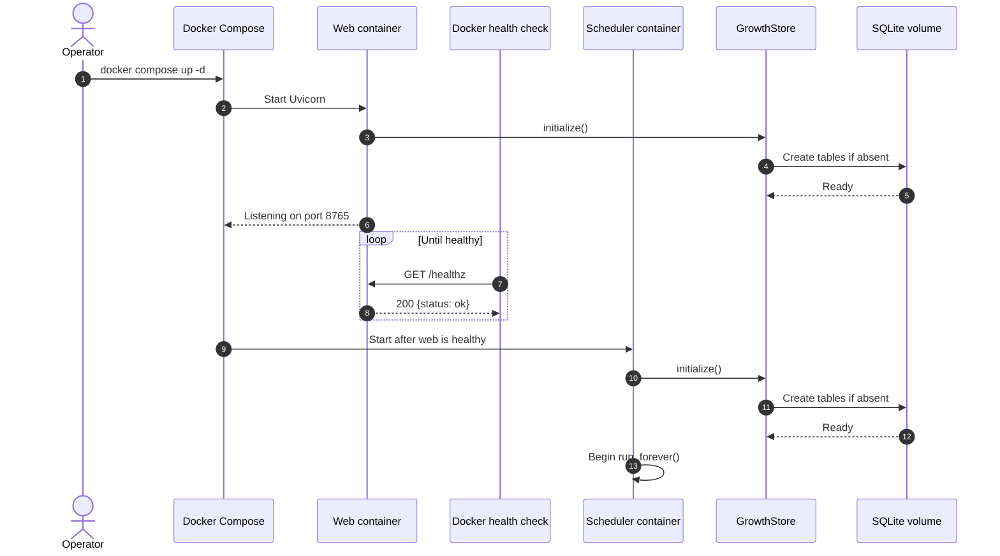
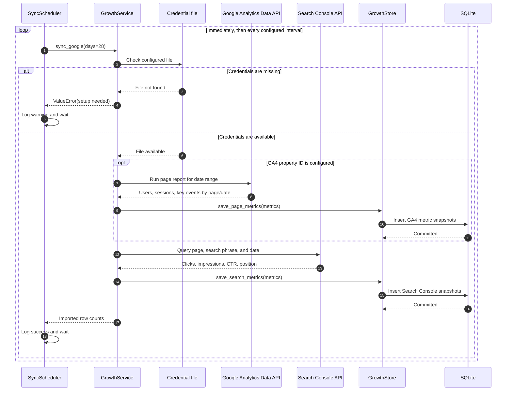
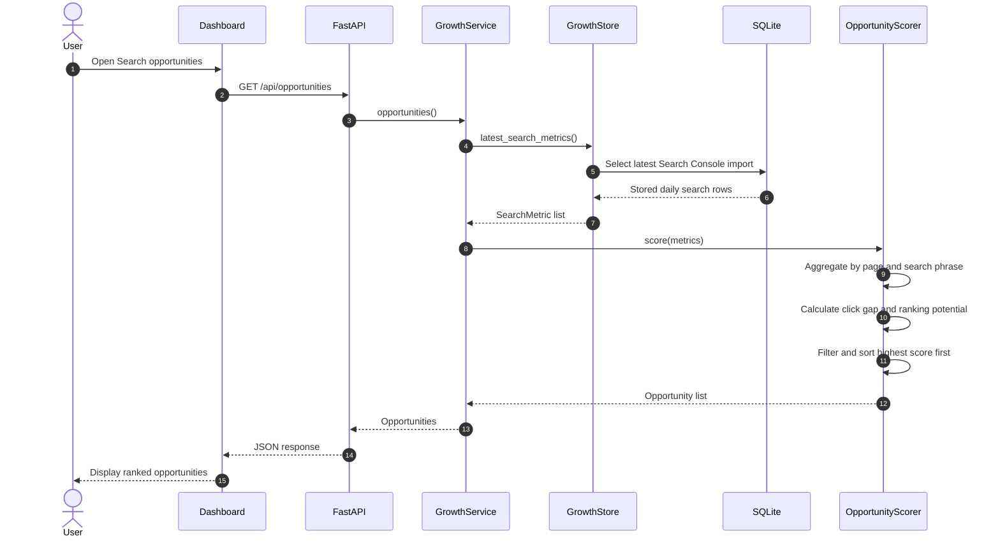
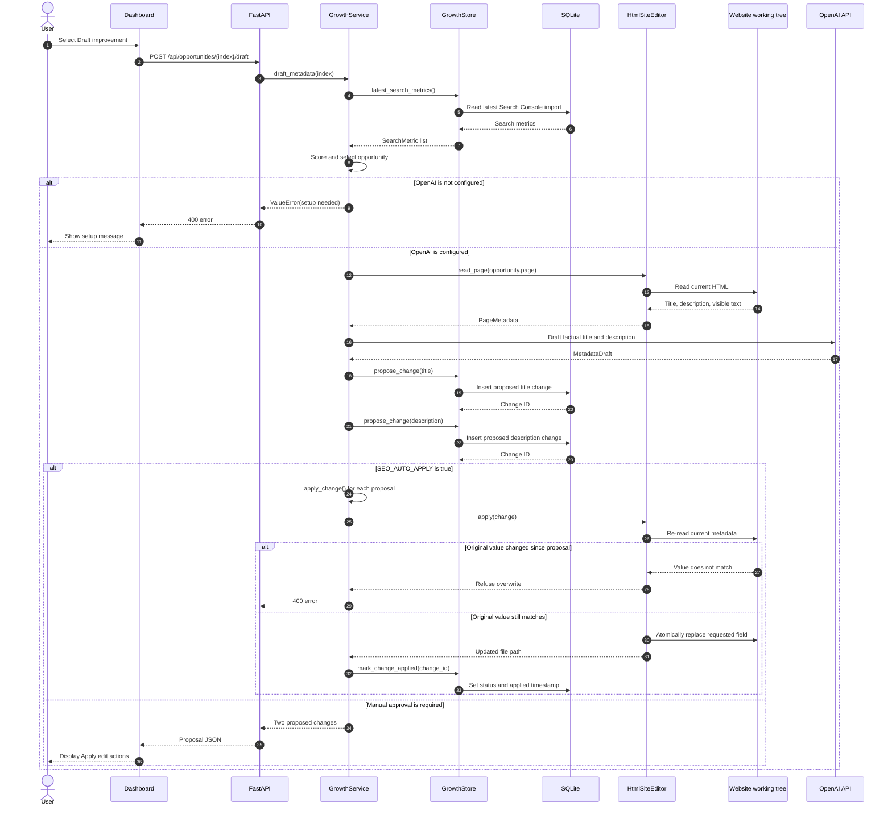
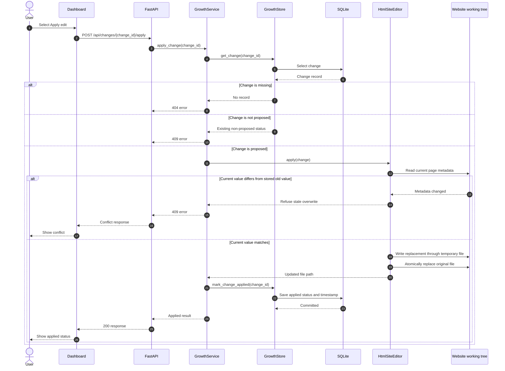

# Sequence diagrams

These diagrams describe the implemented runtime flows for the SEO Growth Assistant.

## Docker Compose startup

The web and scheduler containers share the `seo-data` volume. The dashboard is published only on `127.0.0.1` by default.

## Scheduled Google metrics synchronization

Search Console data is always requested when credentials are configured. GA4 data is optional and is requested only when a GA4 property ID is present.

## Dashboard opportunity calculation

The scorer aggregates daily rows before ranking them. Queries with too few impressions or positions below the configured useful range are excluded.

## AI metadata drafting and safe application

## Manual change application

The website working tree is changed only after the stored old value matches the current page. This prevents a proposal from silently overwriting subsequent manual edits.
